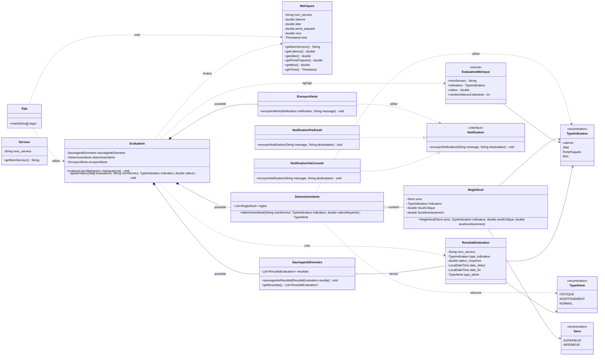

# SOLID VOIP System

Projet Java Maven de base pour le système VOIP.

## Prérequis

- Java 17 ou version supérieure
- Maven 3.9 ou version supérieure

## Commandes

Compiler et exécuter les tests :

```powershell
mvn test
```

Lancer l'application :

```powershell
mvn exec:java
```

## Diagramme UML



Le diagramme représente la conception actuelle :

- `Evaluation` utilise `DeterminerAlerte` pour appliquer les règles d’alerte ;
- `DeterminerAlerte` conserve une liste de règles `RegleSeuil` ;
- `RegleSeuil` définit le sens de comparaison et les seuils critique et avertissement ;
- `EnvoyerAlerte` dépend de l’interface `Notification` ;
- `NotificationParEmail` et `NotificationViaConsole` implémentent cette interface ;
- `SauvegardeDonnees` conserve les résultats d’évaluation ;
- les maps utilisées temporairement par `evaluer` sont des variables locales.
