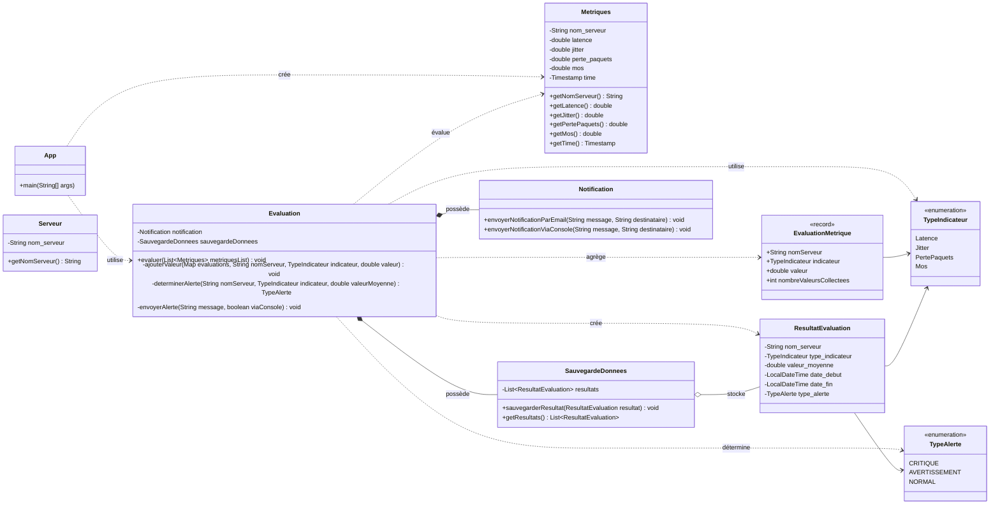

# SOLID VOIP System

Projet Java Maven de base pour le système VOIP.

## Prérequis

- Java 17 ou version supérieure
- Maven 3.9 ou version supérieure

## Commandes

Compiler et exécuter les tests :

```powershell
mvn test
```

Lancer l'application :

```powershell
mvn exec:java
```

## Diagramme UML



Le diagramme représente les dépendances entre les classes et les deux énumérations.
Les maps utilisées temporairement par `evaluer` sont des variables locales et ne
sont donc pas des attributs de `Evaluation`.
